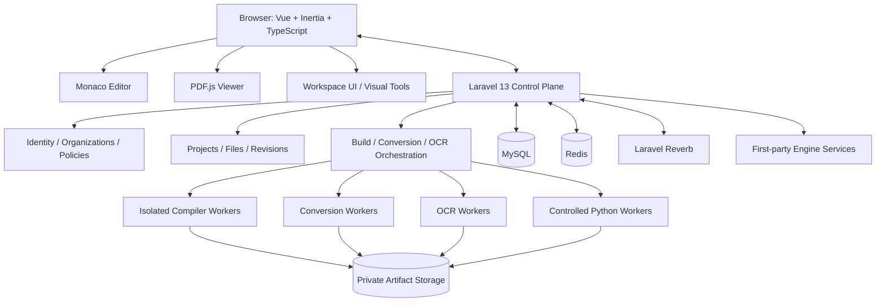
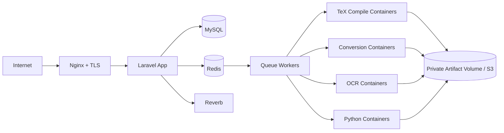
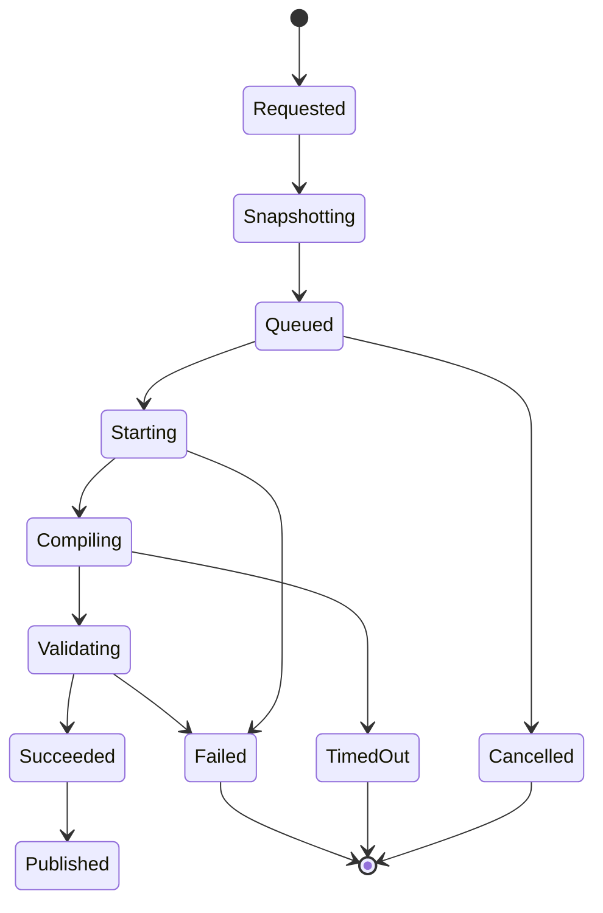

# 02 — System Architecture and Technology Design

## 1. Logical architecture



## 2. Planes and boundaries

### Presentation plane
Vue 3.5, Inertia 3, TypeScript, Tailwind CSS 4.1, Monaco, PDF.js and first-party UI components. Client-side code must not contain secrets or authoritative permission decisions.

### Control plane
Laravel handles authentication, organization/project membership, policies, APIs, storage metadata, revisions, quotas, audit, jobs and worker coordination. Controllers remain thin. Domain logic belongs in domain services/actions and typed DTOs.

### Execution plane
Dedicated, isolated containers or worker pools for:
- LaTeX compilation.
- Document conversion.
- OCR/model inference.
- Python/script execution.
- Future Typst compilation.

Each worker class has a distinct image, security profile, queue, quota policy and protocol. Do not run user code inside the Laravel web container.

### Engine plane
First-party services for LaTeX language analysis, math parsing, document model, dependency analysis, diagnostics normalization, build scheduling and provider orchestration.

## 3. Technology baseline

| Component | Choice | Notes |
|---|---|---|
| Backend | Laravel 13 / PHP | Domain and application orchestration |
| Frontend | Inertia.js 3 + Vue 3.5 + TS | SPA-style workspace |
| CSS | Tailwind CSS 4.1 | Design system |
| Editor | Monaco | Required preference; implement custom providers |
| PDF viewer | PDF.js | Viewer integration and annotation/navigation |
| Database | MySQL | Durable metadata |
| Queue/cache | Redis | Queues, locks, throttling, cache |
| Realtime | Laravel Reverb | Introduce after revision semantics |
| Compiler | TeX Live adapter | Initial compatibility engine |
| Optional compiler | Tectonic adapter | Capability-tested; not equivalent to full TeX Live |
| Conversion | First-party pipeline + optional Pandoc | Preserve source; loss-aware reports |
| OCR | Provider interface; Python service if needed | Model isolation |
| Deployment | Ubuntu + Nginx + Docker | Private workers and artifacts |

Pin exact dependency versions in lockfiles. Verify framework/runtime compatibility before upgrades.

## 4. Suggested Laravel domain structure

```text
app/
  Domain/
    Identity/
    Organizations/
    Projects/
    Files/
    Revisions/
    Compilation/
    Diagnostics/
    Bibliography/
    Templates/
    Collaboration/
    Integrations/
    Documents/
    Mathematics/
    Recognition/
    Administration/
    Usage/
  Actions/
  DTOs/
  Enums/
  Events/
  Http/
    Controllers/
    Requests/
    Resources/
  Jobs/
  Models/
  Policies/
  Services/
    Compiler/
    Conversion/
    Storage/
    Git/
    References/
    AI/
  Support/
```

Use bounded contexts. Avoid a monolithic ProjectService. Each domain owns its validation and state transitions.

## 5. Suggested Vue structure

```text
resources/js/
  components/
    workspace/
    project/
    editor/
    compiler/
    pdf/
    bibliography/
    collaboration/
    templates/
    visual-tools/
    conversion/
    recognition/
    ai/
    integrations/
    admin/
  pages/
    Dashboard/
    Projects/
    Workspace/
    Templates/
    Organization/
    Admin/
    Settings/
  composables/
    useProject.ts
    useProjectFiles.ts
    useAutosave.ts
    useCompilation.ts
    useEditor.ts
    usePdfViewer.ts
    useDiagnostics.ts
    useCollaboration.ts
  services/
    api/
    latex/
    mathematics/
    documents/
    integrations/
  types/
```

## 6. Workspace layout

Desktop:
- Left panel: file explorer, outline, symbols, search and project tools.
- Centre: Monaco editor with tabs, status bar and diff mode.
- Right: PDF preview, math preview, diagnostics or review panel.
- Bottom/drawer: compile log, terminal-like safe log viewer, comments or AI assistant.

Panels must be resizable, collapsible and persisted per user. On mobile, switch to tabs/stacked panels.

## 7. Core backend services

- ProjectService: project lifecycle and project settings.
- ProjectFileService: path-safe file CRUD and storage.
- RevisionService: immutable snapshots and restore.
- CompilationManager: build lifecycle and compiler adapter selection.
- WorkerDispatcher: dispatch and monitor isolated worker tasks.
- DiagnosticsNormalizer: convert compiler output to stable diagnostic schema.
- ArtifactPublisher: validate and publish artifacts.
- TemplateService: template gallery and private template governance.
- IntegrationManager: OAuth tokens and provider adapters.
- DocumentConversionManager: import/export jobs and conversion reports.
- AIActionService: diff proposals, review and apply workflow.
- CollaborationService: presence, comments, suggestions and document events.

## 8. Deployment topology



Start with private local storage plus off-server backups. Add S3-compatible storage when scale or availability requires it. Do not expose storage paths directly.

## 9. Build lifecycle



The current preview references a successful build ID. Failed builds update status/logs only; they never replace the last successful PDF.

## 10. Autosave and build race protection

- Debounce editor saves (initial target 500–1000 ms, tune by measurement).
- Server returns persisted revision/ETag.
- Explicit compile first commits the editor buffer, then snapshots a revision.
- Auto-compile debounce initially 1.5–2 seconds after a stable save; user can disable it.
- Coalesce queued obsolete build requests.
- Never assume an older running build represents the latest source.
- Show PDF revision and stale indicator.
- Use idempotency keys and per-project locks.

## 11. Real-time collaboration architecture

Do not add CRDT collaboration in the first release. First implement:
- Server-acknowledged saves.
- Immutable revisions.
- Conflict detection.
- Comment anchoring.
- Restore and compare.
Then select a collaboration protocol/CRDT behind an adapter. Yjs can be evaluated as a protocol component, but persistence, authorization, revision export and audit remain platform-owned.
